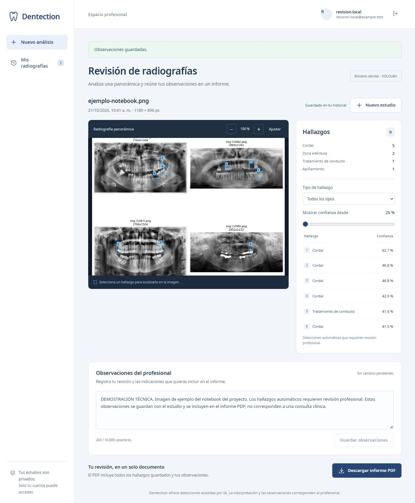
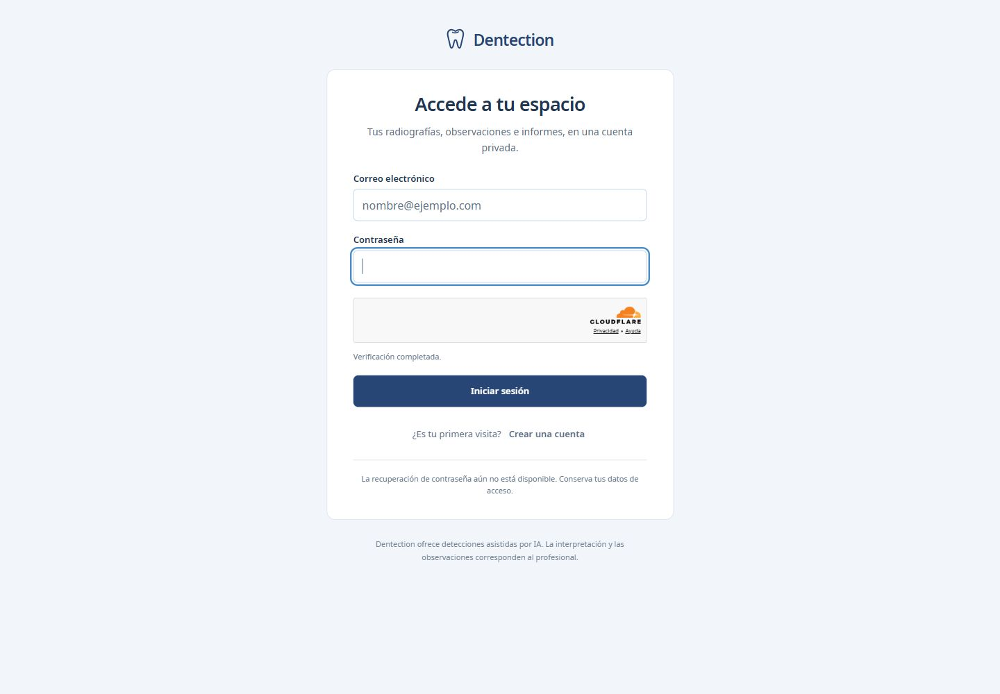
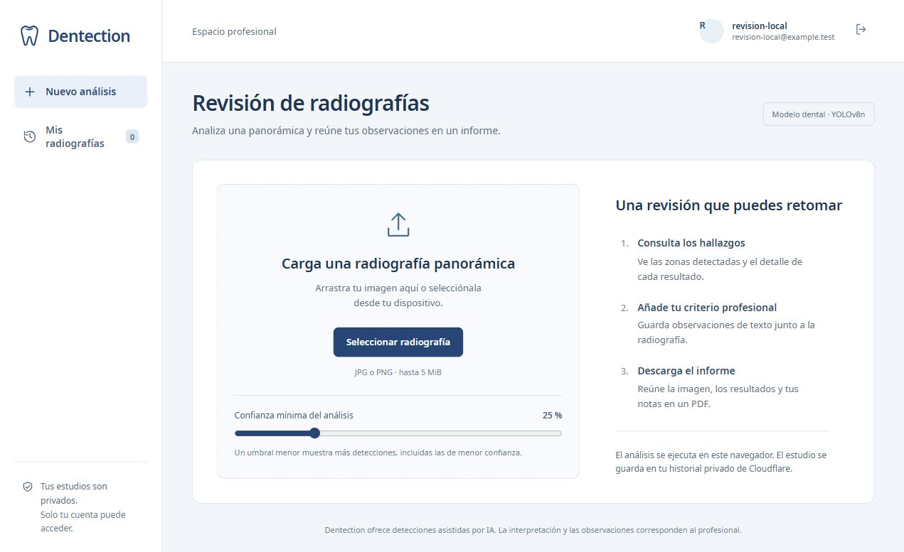
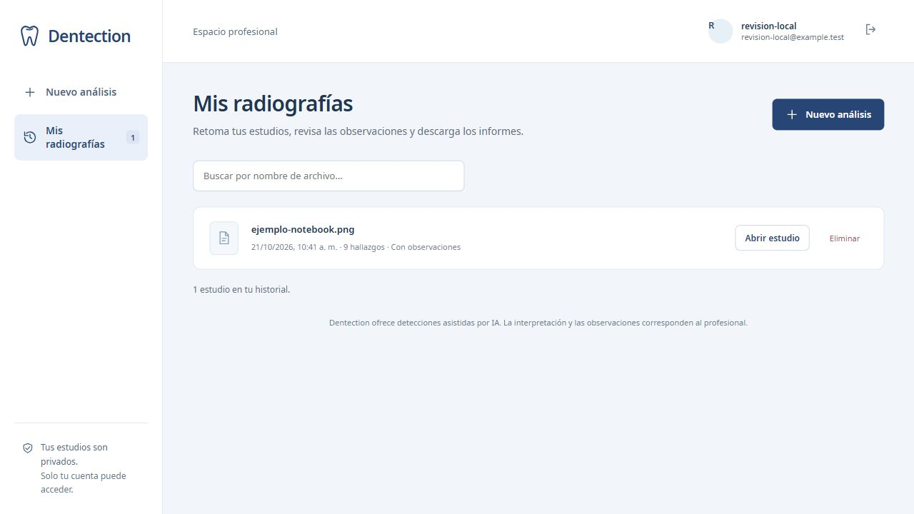

# Dentection Deployed

**Revisión asistida de radiografías panorámicas dentales con inteligencia artificial, desde el navegador.**

Dentection es un prototipo académico dirigido a profesionales de salud oral. Permite analizar una radiografía, revisar los hallazgos sugeridos por un modelo de IA, añadir observaciones y descargar un informe en PDF. Cada profesional dispone de una cuenta y un historial privado de sus estudios.

**[Abrir la aplicación](https://dentection.natalia-moreno-mon.workers.dev)** · [Repositorio original](https://github.com/natam226/Dentection) · [Documentación técnica](web/README.md)

Funciona en navegadores de escritorio y celulares; no requiere instalar una aplicación. Este repositorio independiente reúne la versión web desplegada y conserva el historial del proyecto original.

> Las detecciones son un apoyo para la revisión profesional. El proyecto no cuenta con validación clínica adicional y sus resultados no sustituyen un diagnóstico.

## ¿Qué puedes hacer?

- **Crear una cuenta sin invitación:** registro con nombre, correo y contraseña, protegido por Cloudflare Turnstile. La contraseña debe tener al menos 15 caracteres.
- **Analizar una radiografía panorámica:** carga de imágenes JPG o PNG de hasta 5 MiB y 40 megapíxeles, con umbral de confianza configurable.
- **Consultar resultados generales y detallados:** resumen de hallazgos, cajas sobre la imagen, clase y confianza de cada detección, filtros y zoom.
- **Escribir observaciones:** notas de texto del profesional, guardadas junto con el estudio y diferenciadas de las detecciones automáticas.
- **Descargar un PDF:** informe con la radiografía, los resultados y las observaciones, listo para compartir manualmente.
- **Consultar el historial privado:** recuperar estudios de la misma cuenta entre sesiones, buscar por nombre de archivo y eliminar estudios.

### Recorrido de uso

1. Abre la aplicación y selecciona **Crear una cuenta**, o inicia sesión si ya tienes una.
2. Carga una radiografía panorámica y ajusta el umbral de confianza.
3. Ejecuta el análisis y revisa las detecciones sobre la imagen y en el listado.
4. Escribe tus observaciones y guárdalas.
5. Descarga el informe en PDF o vuelve al estudio desde el historial.

El primer análisis necesita descargar el modelo y su runtime, aproximadamente 27 MB en conjunto. El tiempo de procesamiento depende del dispositivo, especialmente en celulares.

## Capturas de la aplicación

### Resultados, observaciones e informe

El visor muestra las zonas detectadas, un resumen por tipo de hallazgo y el detalle de confianza. En la misma pantalla se guardan las observaciones del profesional y se descarga el informe PDF.



<details>
<summary>Ver el acceso, la carga de imágenes y el historial</summary>

### 1. Acceder a tu espacio

El inicio de sesión permite entrar a la cuenta del profesional. Desde esta pantalla también se puede abrir el registro, sin invitación.



### 2. Cargar una radiografía

Selecciona una imagen JPG o PNG y ajusta la confianza mínima antes de analizarla.



### 3. Retomar un estudio

El historial permite buscar por nombre de archivo y abrir los estudios guardados para revisar sus hallazgos, observaciones e informes.



</details>

Las vistas de revisión e historial corresponden a la demostración local, con una identidad ficticia y una imagen de ejemplo ya incluida en el notebook público del proyecto. Las detecciones proceden de la comprobación técnica del modelo; no representan una consulta ni una validación clínica. [Procedencia de las capturas](docs/images/README.md).

## ¿Cómo funciona la IA?

Se utiliza el modelo **YOLOv8n** del proyecto original, exportado al formato **ONNX**. La inferencia se ejecuta en el navegador mediante ONNX Runtime Web y WebAssembly; no necesita un servidor de inferencia con GPU.

El modelo contempla 14 clases: tratamiento de conducto, fractura, diastema, cordales, quiste periapical, diente retenido, caries, zona déntula (`zona_dentula` en los metadatos), dientes sanos, apiñamiento, diente rotado, supernumerario, enanismo radicular y residuo radicular. Se conservan las categorías del modelo original, incluidas las que describen condiciones o tratamientos y no necesariamente anomalías.

**El procesamiento en el navegador no implica que la radiografía permanezca solo en el dispositivo:** al guardar el estudio, el original se envía a Cloudflare KV y los resultados, parámetros y notas se almacenan en D1, asociados a la cuenta del profesional.

Esta versión no incluye reentrenamiento ni comparación de nuevos modelos. La comprobación de equivalencia entre Python y el navegador es una prueba técnica de ejecución, no una medición de precisión clínica.

## Tecnologías y arquitectura

| Componente | Tecnología | Responsabilidad |
| --- | --- | --- |
| Interfaz | TypeScript + Vite | Carga, visor, resultados, notas e historial adaptable a móvil |
| Inferencia | YOLOv8n + ONNX Runtime Web | Ejecutar el modelo en el navegador con WebAssembly |
| Web y API | Cloudflare Workers + Static Assets | Servir la aplicación y autorizar el acceso a los estudios |
| Datos | Cloudflare D1 | Perfiles, cuentas, sesiones, estudios, resultados y notas |
| Imágenes | Cloudflare KV | Guardar los originales de las radiografías |
| Protección del acceso | Cloudflare Turnstile | Verificar registro e inicio de sesión |
| Informes | jsPDF | Generar el PDF en el navegador |

La API comprueba la propiedad del estudio en cada acceso. Las contraseñas se almacenan mediante derivación criptográfica con sal y un secreto del servidor; las sesiones utilizan cookies `Secure`, `HttpOnly` y `SameSite=Strict`, con duración de 8 horas. Los secretos de producción se configuran en Cloudflare y no se incluyen en Git.

## Ejecutar en tu equipo

### Requisitos

- Git.
- Node.js 22.12 o superior (compatible con Vite y Vitest).
- pnpm disponible en la terminal.

El archivo `web/public/model/model.onnx` **ya está incluido**. No necesitas Python ni volver a entrenar o exportar el modelo para ejecutar la web.

### Inicio rápido: demostración local

Desde PowerShell o una terminal, clona el repositorio e instala las dependencias:

```powershell
git clone https://github.com/natam226/Dentection-Deployed.git
cd Dentection-Deployed/web
pnpm install --frozen-lockfile
```

Compila la interfaz, prepara la base de datos local y arranca el servidor:

```powershell
pnpm build
pnpm exec wrangler d1 migrations apply DB --local --config wrangler.local.jsonc
pnpm run preview:local
```

Abre **http://127.0.0.1:8787**, o la dirección que indique Wrangler si el puerto está ocupado. Para detener el servidor, pulsa `Ctrl+C`.

Esta modalidad permite probar carga, análisis, notas, historial y PDF **sin cuenta de Cloudflare ni secretos de producción**. Usa una identidad ficticia compartida en tu entorno local, con datos guardados localmente por Wrangler. No reproduce el registro ni el inicio de sesión reales. La entrada `worker/dev.ts` solo acepta solicitudes desde localhost y no debe desplegarse.

### Desarrollo con recarga automática

Mantén `pnpm run preview:local` activo como API local. En una segunda terminal, desde `web/`, ejecuta:

```powershell
pnpm dev
```

Abre la dirección que muestre Vite, normalmente **http://127.0.0.1:5173**. Vite redirige las solicitudes `/api` al Worker local en el puerto 8787. Si cambias ese puerto, ajusta el proxy en `web/vite.config.ts`. Para ver cambios del Worker, Wrangler recarga su entrada; para actualizar los archivos servidos directamente en 8787, vuelve a ejecutar `pnpm build`.

### Verificar el proyecto

Desde `web/`:

```powershell
pnpm test
pnpm build
```

`pnpm test` ejecuta las pruebas de detección, autenticación, registro, Turnstile, aislamiento entre cuentas, guardado y cuotas. `pnpm build` prepara el runtime, comprueba TypeScript de la interfaz y del Worker, y genera `web/dist/`.

`pnpm dev` por sí solo sirve la interfaz: necesita el Worker local activo para que funcionen las operaciones de la API.

## Desplegar en Cloudflare

La aplicación utiliza Workers, D1, KV y Turnstile. Se configuró para trabajar con cuotas gratuitas; tanto Cloudflare como la aplicación tienen límites de uso.

**La configuración incluida apunta al despliegue existente de Dentection.** Si usarás otra cuenta, crea tus propios recursos antes de desplegar y actualiza `web/wrangler.jsonc`:

| Configuración | Qué debes establecer |
| --- | --- |
| `name` y `account_id` | Nombre del Worker y cuenta de destino |
| `d1_databases` | Tu base D1; conserva el binding `DB` y la carpeta `migrations` |
| `kv_namespaces` | Tu namespace KV; conserva el binding `IMAGES` |
| `vars.TURNSTILE_SITE_KEY` | Clave pública de tu widget Turnstile |
| Hostnames del widget | Dominio final de la aplicación autorizado en Turnstile |

Desde `web/`, con los recursos configurados:

```powershell
pnpm exec wrangler login
pnpm exec wrangler d1 migrations apply DB --remote
```

En un **despliegue nuevo**, configura estos dos secretos mediante las solicitudes interactivas de Wrangler:

```powershell
pnpm exec wrangler secret put AUTH_PEPPER
pnpm exec wrangler secret put TURNSTILE_SECRET_KEY
```

- `AUTH_PEPPER`: un valor aleatorio de al menos 32 bytes. Consérvalo de forma segura: reemplazarlo en una aplicación con cuentas existentes impide verificar sus contraseñas.
- `TURNSTILE_SECRET_KEY`: clave secreta del mismo widget cuya clave pública configuraste. No debe aparecer en el código ni en el README.

Finalmente:

```powershell
pnpm run deploy
```

Este comando compila y publica la aplicación. Utiliza la configuración de producción, cuya entrada es `worker/index.ts`.

Para actualizar el despliegue existente, conserva sus recursos y secretos; aplica únicamente las migraciones pendientes y despliega. Copiar este repositorio no duplica los usuarios ni los estudios de Cloudflare. La aplicación tampoco incluye un flujo de despliegue automático desde GitHub.

Consulta [la documentación técnica de la web](web/README.md) para detalles de autenticación, pruebas de cuentas, recuperación y persistencia.

## Estructura del repositorio

```text
Dentection-Deployed/
├── web/
│   ├── src/                  # Interfaz, inferencia, visor e informes
│   ├── worker/               # API, autenticación y entrada de demostración local
│   ├── migrations/           # Esquema y cambios de D1
│   ├── tests/                # Pruebas automatizadas
│   ├── public/model/         # Modelo ONNX y metadatos
│   ├── public/fonts/         # Fuentes locales
│   ├── wrangler.jsonc        # Configuración de producción
│   └── wrangler.local.jsonc  # Configuración de demostración local
├── modelo/                   # Pesos originales .pt y notebook de entrenamiento
├── scripts/export_model.py   # Exportación ONNX y comparación técnica local
├── requirements.txt          # Dependencias opcionales para exportar con Python
├── docs/                     # Diseño, planes y evidencia del desarrollo
├── PRODUCT.md                # Contexto y alcance del producto
└── DESIGN.md                 # Sistema visual
```

La aplicación anterior de Streamlit permanece en el historial de Git como referencia; la versión actual se ejecuta desde `web/`.

### Volver a exportar el modelo (opcional)

Solo es necesario si vas a regenerar el ONNX a partir de los pesos originales. Desde la raíz del repositorio, en Windows:

```powershell
python -m venv .venv-export
.venv-export\Scripts\python -m pip install -r requirements.txt
.venv-export\Scripts\python scripts/export_model.py
```

El script actualiza el modelo y sus metadatos, y genera muestras locales de comparación en `work/parity/`, fuera de los archivos públicos. No entrena un modelo nuevo. Las dependencias, el runtime WASM generado, `dist/`, `.wrangler/`, `.dev.vars` y las muestras temporales están excluidos de Git.

## Alcance y limitaciones actuales

- Es un prototipo académico; no se ha realizado una validación clínica adicional ni una auditoría para uso asistencial con datos reales.
- El correo identifica la cuenta, pero todavía no se verifica. No hay recuperación automática de contraseña ni comprobación de credenciales profesionales.
- Las anotaciones son texto: no se dibujan marcas manuales sobre la radiografía. El envío del PDF al paciente se realiza fuera de la aplicación.
- La aplicación limita los originales a **500 MiB en total**, con **200 cargas diarias globales** y **50 por profesional**, por día UTC. Borrar un estudio no reinicia el contador diario. Estas son cuotas de la demostración, independientes de las del proveedor.
- KV puede tardar en propagar una imagen recién guardada. Si aparece un aviso de sincronización, vuelve a abrir el estudio tras unos segundos.
- La búsqueda del historial filtra las páginas ya cargadas; la interfaz permite cargar estudios anteriores.

## Créditos

Esta versión web parte de [Dentection](https://github.com/natam226/Dentection), proyecto original de 2025 desarrollado por:

- [Valentina Bueno Collazos](https://github.com/valentinabc19)
- [Liseth Esmeralda Erazo Varela](https://github.com/memerazo)
- [Natalia Moreno Montoya](https://github.com/natam226)

Se conservan los pesos, el notebook y el historial del trabajo original. Este repositorio reúne su adaptación al navegador y el despliegue en Cloudflare.
